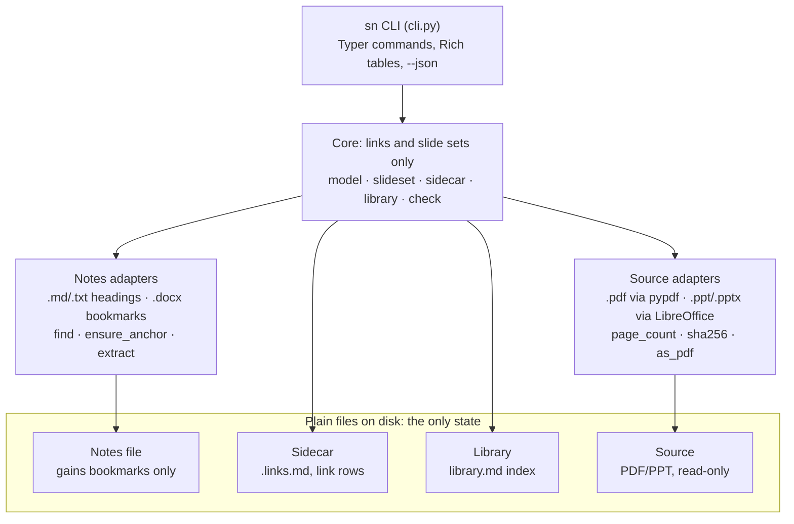

# SlideNotes v0.1 — Design Document

*As of 2026-11-02 · Author: Subham*

Related: [FEATURES.md](FEATURES.md) · [ROADMAP.md](ROADMAP.md)

---

## 1. Overview

SlideNotes v0.1 is a pip-installable CLI that links any slide or page of a PDF/PPT to any section of a notes file (Word, Markdown or text), many-to-many, without screenshots and without modifying the source or the notes text.

**Problem.** Today notes live in Word files padded with slide screenshots. CS224N Lecture 1 notes are 10.6 MB for about 2,600 words, almost all of it 14 pasted screenshots. The link between a slide and its explanation exists only visually, so it cannot be searched, checked or reused.

**Goals for v0.1**

- Register a source (PDF, PPT, PPTX) together with one or more notes files.
- Link slide/page ranges to notes sections, n:n: one slide to many sections across files, one section to many slides.
- Keep the mapping in a human-readable Markdown sidecar next to the source, with clickable links.
- Keep a library file listing every registered source: the intro page.
- Show, from the terminal, the notes text linked to a given slide.
- Detect broken links after notes are edited, renamed or moved.

**Non-goals for v0.1**

- No GUI or split-screen viewer (planned for v0.3).
- No editing of notes inside the tool; notes are written in Word, VS Code, Obsidian or any editor.
- No region- or highlight-level anchors on the slide; links are per slide/page.
- No cloud sync, accounts or database server.

**Design principles**

- **Plain files are the truth.** Delete the tool and every link is still readable.
- **Never touch the source.** PDFs and PPTs are read-only; Word files only ever gain invisible bookmarks.
- **Stable anchors.** Links point at headings or bookmarks, never at line or page numbers.

---

## 2. Core concepts

Six objects make up the whole model; the link is the only one that carries the n:n relationship.

| Concept | What it is | Where it lives |
| --- | --- | --- |
| Source | A PDF, PPT or PPTX being studied. Identified by path plus SHA-256 of its bytes, so a moved file can be re-found. | Anywhere on disk; never modified |
| Notes file | A .docx, .md or .txt holding explanations. A source can have several; a notes file can serve several sources. | Anywhere; path stored relative to the sidecar |
| Anchor | A stable named spot inside a notes file: a Word bookmark, or a Markdown/text heading. | Inside the notes file |
| Link | One row: a slide set (for example `4-6, 9`) joined to one anchor. Many rows per slide and per anchor give n:n. | In the sidecar |
| Sidecar | `<source-name>.links.md` beside the source: header (source, hash, notes files) plus the link table. | Same folder as the source |
| Library | `~/.slidenotes/library.md`: one row per registered sidecar. The intro page. | User home, configurable |

**How n:n works.** Every link is a row of (slides, notes file, anchor). Slide 4 linked to three sections is three rows. One section covering slides 3 and 7 is one row with `3, 7`. Querying slide 4 means expanding every row's slide set and collecting the rows that contain 4.

**Slide numbering.** Slides are 1-based and match the page number shown by the PDF viewer. For PPT/PPTX, slide N is page N of the converted PDF; hidden slides are excluded and v0.1 warns when it finds any.

---

## 3. File formats

All state lives in two kinds of Markdown file, the sidecar and the library, plus invisible bookmarks inside Word notes. Both files are readable and hand-editable; the CLI tolerates manual edits and `sn check` validates them.

### 3.1 Sidecar: `lecture1.links.md`

```markdown
---
slidenotes: 0.1
source: lecture1.pdf
source_sha256: 3f2a9c1e5b7d...
source_pages: 32
notes:
  - lecture1.docx
  - ../derivations/word-vectors.md
---

# Links: lecture1.pdf

| Slides | Notes | Anchor | Label |
|--------|-------|--------|-------|
| 3 | [lecture1.docx](lecture1.docx) | sn_wordnet | WordNet |
| 3, 7 | [lecture1.docx](lecture1.docx) | sn_wordnet_vs_w2v | WordNet vs Word2Vec |
| 4-6 | [lecture1.docx](lecture1.docx) | sn_one_hot | 2.1 One-Hot Representation |
| 4 | [word-vectors.md](../derivations/word-vectors.md#one-hot-maths) | one-hot-maths | One-hot maths |
```

Rules:

- Front matter is YAML. `source` and `notes` paths are relative to the sidecar's folder.
- `Slides` accepts single numbers, ranges and comma lists: `4`, `4-6`, `3, 7, 10-12`.
- `Anchor` is the machine key; `Label` is the human text and is refreshed by `sn check --fix`.
- Markdown targets carry `#anchor` in the link so they jump in VS Code and Obsidian; Word targets link the file (Word has no URL-fragment jump to bookmarks).
- Rows are kept sorted by first slide, then by notes file.
- Free text below the table is preserved untouched, so the sidecar can hold your own remarks.

### 3.2 Library: `~/.slidenotes/library.md`

```markdown
# SlideNotes library

| Source | Notes | Links | Sidecar |
|--------|-------|-------|---------|
| [lecture1.pdf](/home/subham/study/cs224n/lecture1.pdf) | 2 | 12 | [lecture1.links.md](/home/subham/study/cs224n/lecture1.links.md) |
| [vaswani-2017.pdf](/home/subham/papers/vaswani-2017.pdf) | 1 | 7 | [vaswani-2017.links.md](/home/subham/papers/vaswani-2017.links.md) |
```

The library is a cache of the sidecars: `sn library rebuild` regenerates it by rescanning known folders, so it can be deleted safely. Its location can be changed with the `SLIDENOTES_HOME` environment variable.

### 3.3 Anchors per notes type

| Notes type | Anchor | Created by | Survives edits? |
| --- | --- | --- | --- |
| .docx | Word bookmark named `sn_<slug>` placed on the target paragraph | `sn link` finds the heading or paragraph text and inserts the bookmark | Yes; bookmarks move with their text |
| .md | Heading slug, GitHub style (`## One-hot maths` → `one-hot-maths`) | Already present; `sn link` resolves it | Yes, unless the heading is renamed |
| .txt | A line starting with `#` used as a heading | Already present; `sn link` resolves it | Yes, unless the line is renamed |

**Section extent.** A section runs from its anchor to the next heading of the same or higher level (Markdown), or to the next paragraph with a Heading style of the same or higher level (Word). For a bookmark on a non-heading paragraph, the section runs to the next heading of any level.

**Why not Word page numbers.** A .docx stores no pages; Word computes them on every render, so they shift with any edit and differ between machines. `sn show` reports an approximate current page for orientation only.

---

## 4. CLI reference

The command is `sn`, installed by `pip install slidenotes`. Every command that writes is safe to rerun, and every command takes `--dry-run` to print what it would change.

| Command | What it does |
| --- | --- |
| `sn add SOURCE --notes FILE [--notes FILE ...]` | Creates the sidecar, hashes the source, counts pages, registers it in the library. Rerunning adds new notes files. |
| `sn link SOURCE SLIDES [NOTES] TARGET` | Links a slide set to a section. TARGET is heading text or paragraph text to find; NOTES defaults to the first notes file. For .docx inserts a bookmark. |
| `sn link SOURCE SLIDES NOTES.docx --page N` | Optional, needs LibreOffice: bookmarks the first paragraph currently on Word page N, after confirmation. The page number is not stored. |
| `sn unlink SOURCE SLIDES [NOTES] TARGET` | Removes matching rows. Leaves Word bookmarks in place unless `--purge`. |
| `sn show SOURCE SLIDE [--full]` | Prints every section linked to the slide, grouped by notes file. Default shows the first 20 lines of each; `--full` prints all. |
| `sn map SOURCE` | Prints a slide-by-slide map: each slide, its link count, and unlinked slides marked. |
| `sn sections NOTES` | Lists the headings and existing bookmarks in a notes file, as candidates for TARGET. |
| `sn list` | The intro page: the library table in the terminal, with link counts and broken-link warnings. |
| `sn check [SOURCE]` | Validates sidecars: missing files, changed source hash, anchors not found, slide numbers past the last page. Exit code 1 on problems. |
| `sn check --fix` | Re-finds moved files by hash, refreshes labels, re-resolves renamed headings when one candidate is clearly the match, asks otherwise. |
| `sn open SOURCE [SLIDE]` | Opens the source in the system viewer (at the page where the viewer supports it) and the notes file in its default app. |
| `sn library rebuild` | Regenerates library.md from the sidecars it can find. |
| `sn convert NOTES.docx` | One-time Word to Markdown conversion via pandoc, images extracted to `assets/`, sidecar rows rewritten to the new anchors. |

### 4.1 Example session

```bash
cd ~/study/cs224n
sn add lecture1.pdf --notes lecture1.docx
sn sections lecture1.docx              # see what can be linked
sn link lecture1.pdf 3 "WordNet"
sn link lecture1.pdf 3,7 "WordNet vs Word2Vec"
sn link lecture1.pdf 4-6 "2.1 One-Hot Representation"
sn add lecture1.pdf --notes ../derivations/word-vectors.md
sn link lecture1.pdf 4 word-vectors.md "One-hot maths"
sn show lecture1.pdf 4                 # two sections, two files
sn list
```

### 4.2 Behaviour details

- **TARGET matching.** Exact heading match first, then case-insensitive, then a paragraph starting with the text. Several matches: the CLI lists them numbered and asks; `--nth N` picks one non-interactively.
- **Word files open in Word.** Word locks open documents; `sn link` on a .docx detects the `~$` lock file and stops with a message instead of writing.
- **Backups.** Before the first write to a .docx, the original is copied once to `.slidenotes/backup/`. Sidecars are rewritten atomically (write to a temp file, then rename).
- **Output.** Coloured tables via Rich; `--json` on `show`, `map`, `list` and `check` for scripting and for the future GUI.
- **Approximate page in `sn show`.** Optional; needs LibreOffice to paginate the .docx and is skipped silently without it.
- **`--page N` on Word files.** Optional; needs LibreOffice. The .docx is converted to a temporary PDF, the first paragraph starting on page N is shown for confirmation, then bookmarked. LibreOffice pagination can differ slightly from Word's, which is why confirmation is required. Without LibreOffice the command stops and asks for heading or paragraph text instead.

---

## 5. Architecture

A thin CLI layer sits on a core that knows only links and slide sets; each notes format and each source format is a small adapter behind a common interface, so adding a format never touches the core.



The core writes the sidecar and library itself; it reaches notes and sources only through their adapters.

### 5.1 Package layout

```text
slidenotes/
  pyproject.toml            # entry point: sn = slidenotes.cli:app
  src/slidenotes/
    cli.py                  # Typer commands, Rich output, --json
    core/
      model.py              # Source, NotesFile, Anchor, Link, Sidecar (dataclasses)
      slideset.py           # parse/format "3, 7, 10-12"; contains(); expand()
      sidecar.py            # read/write .links.md (front matter + table), atomic save
      library.py            # read/write library.md, rebuild
      check.py              # validation and --fix logic
    notes/
      base.py               # NotesAdapter: sections(), find(target), ensure_anchor(), extract()
      markdown.py           # .md headings, GitHub slugs
      text.py               # .txt '#' heading lines
      docx.py               # bookmarks via python-docx + lxml, lock detection, backup
    sources/
      base.py               # SourceAdapter: page_count(), sha256(), as_pdf()
      pdf.py                # pypdf
      ppt.py                # LibreOffice headless -> cached PDF
    util/
      paths.py  hashing.py  config.py
  tests/
    fixtures/               # sample.pdf, sample.pptx, sample.md, sample.txt, sample.docx
```

### 5.2 Interfaces

```python
class NotesAdapter(Protocol):
    def sections(self) -> list[Section]: ...              # headings + existing anchors
    def find(self, target: str) -> list[Section]: ...      # candidates for TARGET
    def ensure_anchor(self, section: Section) -> str: ...  # returns anchor id; may write (docx)
    def extract(self, anchor: str) -> str: ...             # section text for `sn show`

class SourceAdapter(Protocol):
    def page_count(self) -> int: ...
    def sha256(self) -> str: ...
    def as_pdf(self) -> Path: ...                          # identity for PDF, cached conversion for PPT
```

### 5.3 Dependencies

| Package | Used for | Required? |
| --- | --- | --- |
| typer | CLI commands and help | Yes |
| rich | Tables and coloured output | Yes |
| pypdf | Page count of PDFs | Yes |
| python-docx (+ lxml) | Reading Word sections, inserting bookmarks | Yes |
| pyyaml | Sidecar front matter | Yes |
| python-pptx | Slide count when LibreOffice is absent | Optional extra: `pip install slidenotes[ppt]` |
| LibreOffice (`soffice`) | PPT/PPTX to PDF; `sn link --page N` on Word files; approximate Word page in `sn show` | Optional, external |
| pandoc | `sn convert` Word to Markdown | Optional, external |

Python 3.10+. No server and no database in v0.1.

### 5.4 PPT handling

`sn add deck.pptx` runs `soffice --headless --convert-to pdf` once and caches the result in `.slidenotes/cache/<sha256>.pdf` next to the source. The sidecar always records the original .pptx; the cache is rebuilt whenever the hash changes. Without LibreOffice, the slide count is read from the .pptx with python-pptx (the optional `slidenotes[ppt]` extra) instead and `sn open` falls back to opening the .pptx.

### 5.5 Errors

Every error names the file, the problem and the command that fixes it, for example:

```text
lecture1.docx: anchor sn_one_hot not found (heading renamed?) → run sn check --fix
```

Exit codes: `0` ok, `1` validation problems, `2` usage error, `3` file locked or unreadable.
