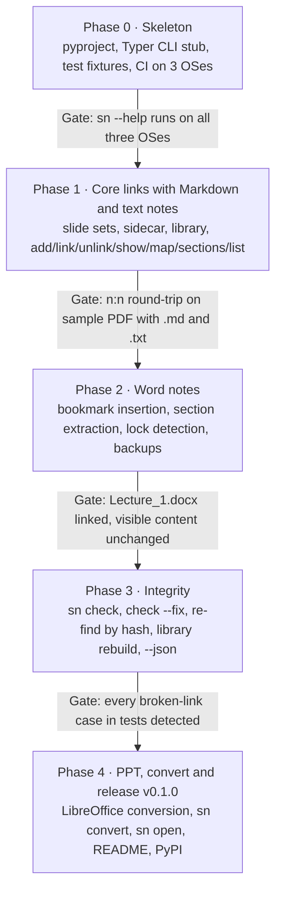

# SlideNotes v0.1 — Phased Plan, Risks and Testing

*As of 2026-11-02*

Related: [DESIGN.md](DESIGN.md) · [FEATURES.md](FEATURES.md)

## 1. Phased plan

v0.1 is built in five phases; each ends with a gate that must pass before the next starts, and Phase 1 alone already gives a usable tool for Markdown notes.

Word support comes after the core because it is the riskiest part; building it on a tested core keeps failures isolated to the adapter.

### Phase 0: Skeleton

- [ ] Create repo, `pyproject.toml` with `sn` entry point, src layout
- [ ] Typer app with stub commands and `--help` text
- [ ] Test fixtures: sample.pdf (10 pages), sample.md, sample.txt, sample.docx, sample.pptx
- [ ] GitHub Actions matrix: Windows, macOS, Linux × Python 3.10 to 3.13

**Done when:** `pip install -e .` then `sn --help` works on all three OSes in CI.

### Phase 1: Core links with Markdown and text notes

- [ ] `slideset.py`: parse, format, contains, validate against page count
- [ ] `sidecar.py`: front matter + table read/write, atomic save, preserve free text
- [ ] `library.py`: add/update rows, rebuild
- [ ] Markdown and text adapters: sections, find, slug, extract
- [ ] Commands: `add`, `link`, `unlink`, `show`, `map`, `sections`, `list`
- [ ] PDF source adapter: page count and SHA-256

**Done when:** on sample.pdf, slide 4 links to three sections in two files, one section links to slides 3, 7 and 9, and `sn show` returns exactly those; the sidecar round-trips byte-identical.

### Phase 2: Word notes

- [ ] docx adapter: list Heading-styled and bold paragraphs as sections
- [ ] Insert `sn_<slug>` bookmarks with targeted lxml edits
- [ ] Section extraction up to the next heading of the same or higher level
- [ ] `~$` lock-file detection; one-time backup to `.slidenotes/backup/`
- [ ] Optional `--page N`: LibreOffice pagination, confirm paragraph, then bookmark; clear message when LibreOffice is missing
- [ ] Safety tests: text and non-bookmark XML unchanged after linking

**Done when:** the real Lecture_1.docx gets 10 links, opens cleanly in Word and LibreOffice, and its text is unchanged.

### Phase 3: Integrity

- [ ] `sn check`: missing files, hash changes, broken anchors, out-of-range slides
- [ ] `sn check --fix`: re-find by hash, refresh labels, suggest closest heading
- [ ] `--json` on `show`, `map`, `list`, `check`
- [ ] Warnings surfaced in `sn list`

**Done when:** each failure type, induced in a test, is reported with the fixing command, and `--fix` repairs moved files and renamed headings.

### Phase 4: PPT, convert and release

- [ ] PPT/PPTX adapter: LibreOffice conversion with cache, python-pptx fallback
- [ ] `sn convert`: pandoc Word to Markdown, images to `assets/`, sidecar rows rewritten
- [ ] `sn open` on Windows, macOS, Linux
- [ ] README with the example session; CHANGELOG
- [ ] Publish `slidenotes 0.1.0` to PyPI

**Done when:** `pip install slidenotes` on a clean machine runs the full example session against a CS224N PDF and a .pptx.

---

## 2. Risks, open questions and testing

The largest risk is Word: bookmark insertion must never alter visible content, so it gets the most tests and a backup before the first write.

### 2.1 Risks

| Risk | Impact | Mitigation |
| --- | --- | --- |
| python-docx rewrites parts of the .docx it does not understand | Lost formatting in user notes | Insert bookmarks with targeted lxml edits only; byte-compare all other parts in tests; backup first |
| User renames a Markdown heading | Links break silently | `sn check` on every `sn list`; `--fix` suggests the closest heading |
| Notes headings in Word are bold text, not Heading styles (true of Lecture 1) | `sn sections` finds too few targets | Match any paragraph by text; `sn sections --all` lists bold paragraphs too |
| Source PDF replaced by a new version with different slide numbers | Links point at wrong slides | Hash change triggers a warning and `sn check` lists links to review |
| LibreOffice missing or slow on PPT | PPT support unusable | Optional dependency, python-pptx fallback for slide count, conversion cached |
| Word file open during `sn link` | Write conflict | Detect `~$` lock file, stop with exit code 3 |

### 2.2 Decisions (resolved 2026-11-02)

| Question | Decision |
| --- | --- |
| Package name | `slidenotes`, confirmed available on PyPI. Command: `sn`. |
| Library scope | One global library at `~/.slidenotes/library.md`. Per-folder filtering (`sn list cs224n`) may come later. |
| Word page numbers as a link target | Optional `--page N` on `sn link`. Default stays heading or paragraph text. See the LibreOffice note below. |

**LibreOffice note.** `--page N` needs LibreOffice installed, because a .docx stores no page numbers. The tool converts the .docx to a temporary PDF with `soffice --headless`, finds the first paragraph that starts on page N, and bookmarks it. After that the link uses only the bookmark; the page number is never stored. Without LibreOffice, `--page` stops with a message to choose by heading or paragraph text instead. Pages from LibreOffice can differ slightly from Word's, so the CLI always prints the paragraph it picked and asks for confirmation. LibreOffice is also used, optionally, for PPT/PPTX conversion and for the approximate page shown by `sn show`.

### 2.3 Testing strategy

- **Unit tests** for slide-set parsing, sidecar round-trip (read, write, read gives identical rows) and slug generation.
- **Golden files** for sidecar and library output, so format changes show up as diffs.
- **Word safety tests**: link into fixture .docx files, then assert document text and every non-bookmark XML part are unchanged; open the result with LibreOffice to confirm it is valid.
- **Real-data acceptance test**: CS224N Lecture 1 PDF with the existing Lecture_1.docx, 10 links including one slide to three sections and one section to three slides.
- **CI**: GitHub Actions on Windows, macOS and Linux, Python 3.10 to 3.13; LibreOffice-dependent tests marked and run on Linux only.
